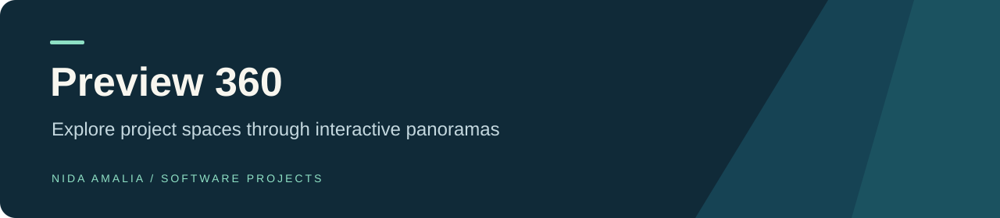

# Preview 360

A project-portfolio frontend with an interactive panorama viewer. Built with React, TypeScript, Vite, Tailwind CSS, shadcn/ui, and Pannellum.

## What to explore

- Browse projects and filter by category.
- Open project details with a panorama, sidebar, and project metadata.
- Zoom, enable automatic rotation, and enter fullscreen in the viewer.
- Responsive page composition with reusable interface components.

## Run locally

Use Node.js 22 LTS and npm.

```bash
git clone https://github.com/nidaamalia/preview-360.git
cd preview-360
npm ci
npm run dev
```

Open the URL printed by Vite. The panorama library and some images load from external hosts, so a network connection is required.

```bash
npm run build
npm run preview
```

## Code tour

| Area | Code |
| --- | --- |
| Panorama lifecycle and controls | [PannellumViewer.tsx](src/components/PannellumViewer.tsx) |
| Project data and image sources | [projects.ts](src/data/projects.ts) |
| Detail page | [ProjectDetail.tsx](src/pages/ProjectDetail.tsx) |
| Portfolio listing | [Portfolio.tsx](src/pages/Portfolio.tsx) |

The viewer wraps an imperative browser library in a React component. Its effect owns setup and cleanup; UI controls talk to the viewer instance through a ref.

## Demo boundaries

Project content is bundled in the frontend; there is no CMS or live project backend. Some sample images are ordinary photographs, not equirectangular panoramas, and will not provide a geometrically correct 360-degree view. Use a genuine 2:1 panorama when evaluating the viewer. Verify permission to reuse project names and photography before publishing a commercial portfolio.

## Suggested walkthrough

Open the portfolio, select a project, then try zoom, rotation, and fullscreen. Switch projects to exercise cleanup and reinitialisation. Network-failure and retry handling remain follow-up work; do not interpret a loading indicator as a successful panorama load.
